# Generator architecture

AlephMapper is an incremental Roslyn source generator. The pipeline registers attribute-based candidates in [`AlephSourceGenerator`](../source/AlephSourceGenerator.cs), creates a semantic `MappingAnalysis` for eligible members, expands expressions, then emits members and diagnostics from [`MapperSourceOutput`](../source/Generation/MapperSourceOutput.cs). The generator produces C# source in the consuming compilation; it does not execute mapping code at build time.

```mermaid
flowchart LR
  A[Attribute syntax candidates] --> B[MapperSourceOutput]
  B --> C[MappingAnalysis and catalog]
  C --> D[Inlining and adaptation rewriters]
  D --> E[Projection, update, adaptation emitters]
  E --> F[MapperGenerationResult]
  F --> G[Generated C# and AM diagnostics]
  G --> H[C# compilation]
  H --> I[Optional LINQ provider translation]
```

`MapperSourceOutput` chooses one primary candidate for a partial mapper, checks the declaration, and gathers mappings across partial files. `MappingAnalysisFactory` binds symbols and resolves class/member attributes. `MappingCatalog` makes supported source bodies available for helper expansion. `InliningResolver` handles nested calls, null conditionals, switch lowering, extension members, and cycle detection. Adaptation uses `AdaptationValidator` and `AdaptedDestinationRewriter` to validate and substitute the explicit source/destination pair.

The three emitters under [`Generation/Emitters`](../source/Generation/Emitters) reserve generated signatures before appending members. `MapperFileEmitter` renders the containing partial declaration. `MapperGenerationResult` carries value-only source and diagnostic results to the incremental output callbacks; compiler-bound semantic state stays inside analysis. Diagnostics are reconstituted against the current compilation before reporting.

Final C# compilation validates generated syntax and types. EF Core or another LINQ provider separately decides whether an expression tree can become a database query. See the [generated API reference](generated-api-reference.md) and [integration tests](../tests/AlephMapper.IntegrationTests) for the tested boundary.
